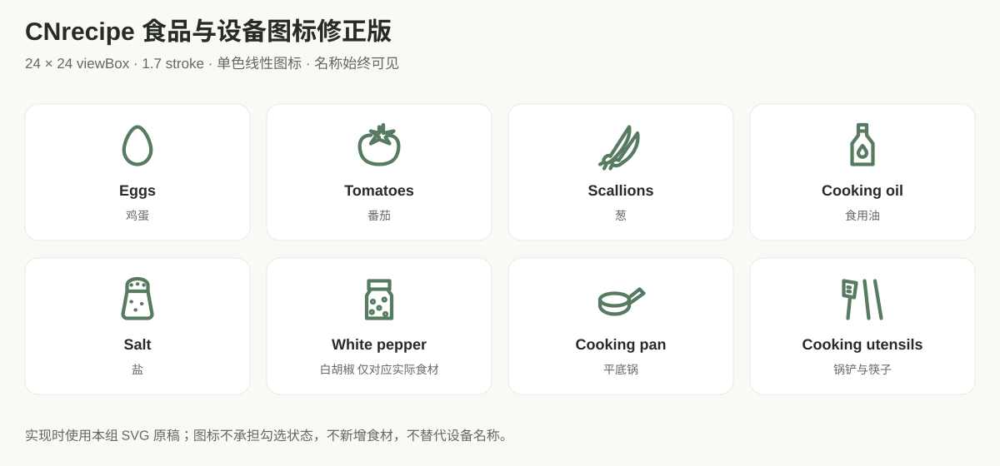
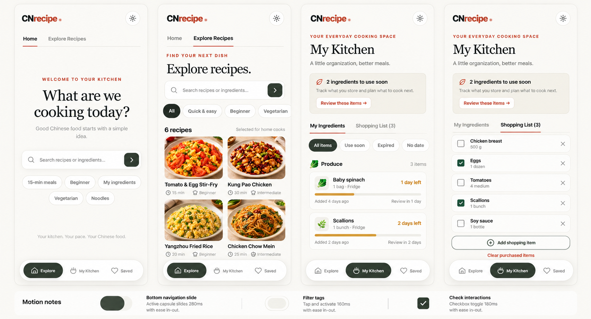
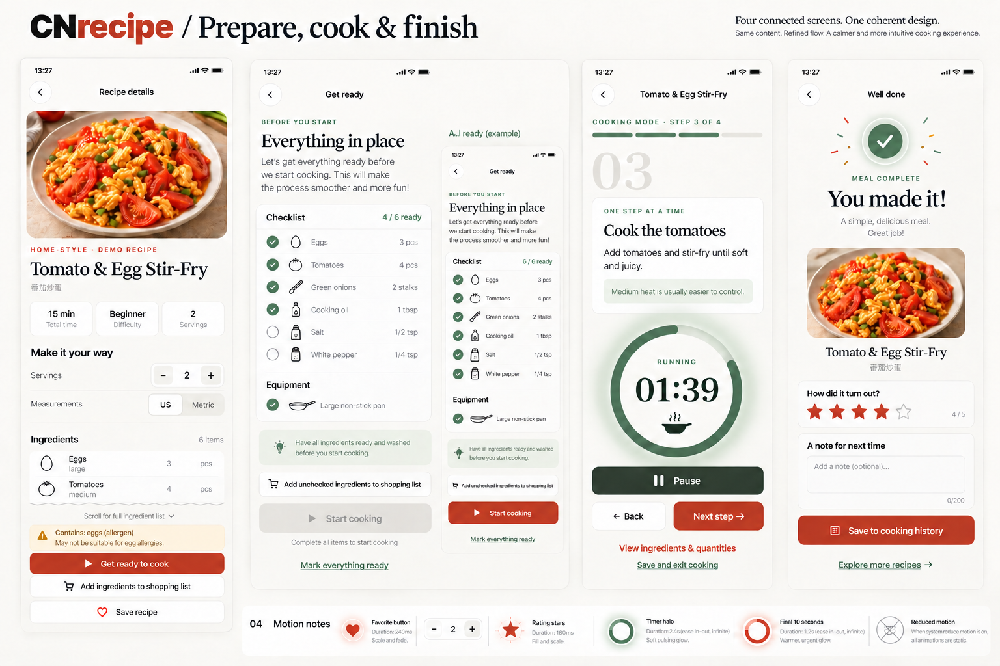
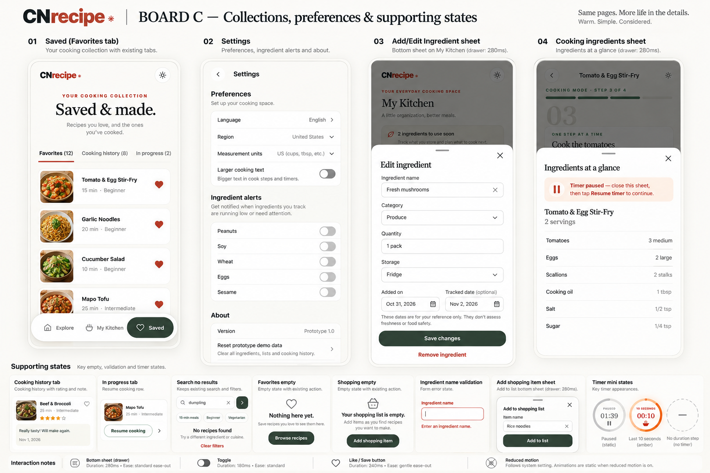

# CNrecipe 全页面优化修改说明

版本 1.0 · 2026 年 10 月 31 日 · 面向设计 研发 测试

本文件整合已确认的页面预览、修正后的食品与设备图标、组件动效和技术实现方案。开发目标是在保留现有页面框架与业务流程的基础上完成全页面优化，并将 Cook 小计时条替换为已选定的圆环计时器。

**确认状态：视觉方向与组件动效已通过；食品与设备图标已补充修正版。当前交付是修改说明和设计资产，不是已实施的 App 更新。**

## 1 设计基线与修改边界

- 保留暖白底色、衬线标题、鼠尾草绿、砖红色和现有卡片风格。
- 主导航仅包含 Explore、My Kitchen、Saved，入口、顺序和悬浮胶囊框架保持不变。
- 保留首页 Home 与 Explore Recipes、厨房 My Ingredients 与 Shopping List、收藏 Favorites 与 Cooking history 与 In progress 的现有层级。
- 详情、备料、Cook、完成和设置继续沿用任务页面结构，不增加底部主导航。
- 优化文字层级、组件间距、状态标签、触控反馈、弹层和动效；不新增账号、云同步、推荐、后台服务或数据库。
- 首页保留中心搜索布局，不添加图片信息流。详情食材保持只读，备料页承担勾选。
- 预览用来确认视觉与信息层级；实际菜名、数量、条数、日期、警告和设备名称全部从现有数据与逻辑读取。

## 2 食品与设备图标修正

旧稿中鸡蛋与厨师帽、番茄与计时图标、锅具与不明确轮廓存在语义偏差。修正版已替换相应预览图，并附独立 SVG 原稿；后续开发直接使用 SVG，不从位图描摹。

| 对象 | 图标语义 | 实现资产 |
| --- | --- | --- |
| Eggs | 单枚椭圆鸡蛋，不使用厨师帽 | assets/icons/egg.svg |
| Tomatoes | 带星形萼片的番茄，不使用时钟或手机 | assets/icons/tomato.svg |
| Scallions | 长叶、葱白和根须，不使用刀具 | assets/icons/scallions.svg |
| Cooking oil | 窄颈油瓶与油滴 | assets/icons/oil.svg |
| Salt | 短宽盐罐与打孔瓶盖，与油瓶区分 | assets/icons/salt.svg |
| White pepper | 有胡椒颗粒的调味罐，仅在真实食材存在时显示 | assets/icons/pepper.svg |
| Cooking pan | 浅锅身与长手柄 | assets/icons/pan.svg |
| Utensils | 锅铲与筷子，与锅具文字配套 | assets/icons/utensils.svg |

统一使用 24 × 24 viewBox、1.7 线宽、圆端点、单色 currentColor，常规显示尺寸 20 至 24 CSS px。图标位与勾选控件分开，图标本身不表达已选状态。名称始终可见；装饰 SVG 使用 aria-hidden，避免重复朗读。

设备名称保留当前的 Cooking pan and utensils 等原有文案，不凭预览改成特殊锅型。食材图标由明确的视图层映射提供，不改变持久化 schema；无法准确匹配时省略对象图标，保留名称，不回退到无关图形。用户自建食材不依赖模糊猜测匹配图标。

## 3 全页面预览

### A 浏览与管理

| 页面 | 优化内容 | 必须保留 |
| --- | --- | --- |
| 首页 | 搜索框焦点、快捷标签反馈、统一字号与留白 | 中心标题、搜索和现有五个快捷入口 |
| 菜谱浏览 | 筛选切换、元信息标签、两列卡片节奏 | 两列菜谱结构、原有搜索与筛选逻辑 |
| 我的食材 | 日期标签、分组卡片、日期比例条 | 原有分组、日期过滤、编辑入口 |
| 购物清单 | 勾选、删除、空态和新增反馈 | 勾选区域与删除按钮分别可达 |

日期状态表达记录日期的剩余时间，不声明食材新鲜或安全。筛选名称与现有行为一致；条目数量由真实集合计算，不复制预览里的示例计数。

### B 详情与烹饪主流程

| 页面 | 优化内容 | 必须保留 |
| --- | --- | --- |
| 菜谱详情 | 份量步进器、单位切换、食材图标和收藏反馈 | 图片与信息顺序、只读用量、备料与购物入口 |
| 备料 | 食材与设备图标、勾选描画、按钮状态 | 全部完成才能开始、加入未勾选食材、一键备妥 |
| Cook | 大数字圆环、进度、呼吸光圈、暂停与抽屉 | 步骤顺序、Back、Next、食材入口、保存退出 |
| 完成评价 | 星级反馈、备注焦点、保存反馈 | 原有记录内容与保存路径 |

本组预览已修正食品与设备图标，最终线条形状以第 2 节 SVG 原稿为准。图中示例白胡椒和特殊锅型不新增到现有菜谱；清单完成数以实际食材加设备项目计算。现有番茄炒蛋数据为五项食材加一项设备，不按示例图硬编码条目或数量。

### C 收藏与辅助状态

| 页面或状态 | 优化内容 | 必须保留 |
| --- | --- | --- |
| 收藏与历史 | 列表节奏、切换反馈、空态 | 三个现有子页、历史评分备注、会话恢复 |
| 设置 | 分组、下拉框、开关、长页滚动 | 原有语言、地区、单位、大字体、过敏原选项 |
| 新增与编辑食材 | 字段一致性、错误位置、键盘可达性 | 名称、分组、用量、存储、日期类型、加入日期、跟踪日期 |
| 新增购物项 | 输入、校验、提交反馈 | 原有商品名称字段与添加行为 |
| 烹饪食材抽屉 | 遮罩、进入退出、暂停说明 | 只读食材与用量，关闭后在主页面恢复计时 |
| 空态与错误 | 原位解释和现有恢复操作 | 保留搜索与过滤控件，不用空白页替代 |

本组图中以下细节由实施规范纠正：编辑表单必须保留 Date label；过敏原说明使用现有“高亮已声明过敏原”语义，不变成库存提醒；版本信息从现有应用读取；无时长步骤完全不显示圆环，图中的虚线圆环不实施。不新增收藏行按钮、字段清空按钮或备注字数限制等预览中偶然出现的控件与规则。

## 4 视觉与组件参数

| 项目 | 建议值 | 约束 |
| --- | --- | --- |
| 页面底色 | #FAF9F6 | 沿用现有 paper |
| 正文 | #272B27 | 沿用现有 ink |
| 描边 | #EAE9E3 | 仅用于非文字边界 |
| 主操作色 | #B64E38 | 不扩大到所有控件 |
| 运行与完成 | #567B61 | 配合图标与文字 |
| 选中胶囊 | #323F35 | 外壳尺寸和导航位置不变 |
| 即将到时 | #CE9E4A | 可作环与浅背景，正文使用足够深的颜色 |
| 圆环直径 | 约 180 至 200 CSS px | 小屏允许原有页面滚动 |
| 计时数字 | 48 至 56 CSS px | 等宽数字，不逐秒弹跳 |
| 控件点击区 | 至少 44 × 44 CSS px | 图标本身可小于点击区 |

保留现有字体体系；输入框与选择框保持现有 iOS 适配，不回退到导致聚焦放大的小字号。普通文字对比度目标至少 4.5 比 1，大字号文字与必要图形至少 3 比 1，实施时对实际前景与背景组合测量，不能仅凭色板宣称通过。

## 5 组件动效规则

| 组件 | 触发与结果 | 时长 |
| --- | --- | --- |
| 悬浮胶囊导航 | 外壳和三个点击区固定，选中底板移动，文字图标同步换色 | 280ms 缓出 |
| 顶部子页与分段控件 | 选中标识平滑切换，内容短淡入，保留原有过滤结果 | 160 至 180ms |
| 收藏 | 触下缩到 0.92，选中填色并到 1.12 后归一，取消恢复描边 | 240ms |
| 普通按钮 | 按下到 0.97，松开归一；禁用态不响应 | 100 至 160ms |
| 备料与购物勾选 | 背景变色和勾线描画，行不移动 | 180ms |
| 份量与筛选 | 数值或颜色局部更新，不改变控件宽度 | 160ms |
| 开关 | 滑块位移与底色同步，不新增设置项 | 180ms |
| 食材抽屉 | 底部进入，遮罩渐显；退出完成后移除节点 | 进入 280ms 退出 220ms |
| 步骤与评分 | 步骤文字短淡入；选中星级短缩放，不反复闪烁 | 180ms |

快速操作以最后状态为准，取消旧动画，不排队、不多次切页。重复点击已选导航不重播。导航点击仍是原有点击交互，不新增整页滑动手势。保存失败需显示真实错误，不用动画或成功提示掩盖失败。

使用系统减少动态效果偏好关闭滑动、缩放、描画和光圈，改为直接切换或不超过 120ms 的淡入；不新增 App 内开关。保留焦点与键盘操作，不每秒朗读计时数字，只播报开始、暂停、到时等状态变化。

## 6 Cook 计时与状态规则

页面顺序保持标题、步骤进度、大步骤号、说明卡、计时器、Back 与 Next、食材入口、保存退出。扩展原计时区域，不压缩说明字号。

| 状态 | UI | 业务行为 |
| --- | --- | --- |
| 未开始 | 建议时长、静态环、Start timer | 不调度计时结束通知 |
| 运行中 | 等宽数字、剩余进度、Running、Pause | 依据 deadline 计算剩余时间 |
| 最后 10 秒 | 琥珀色环、Almost done | 仅增强视觉，不改变截止时间 |
| 暂停 | 静态灰环、Paused、Resume | 冻结 remaining 并取消计时通知 |
| 到时 | 00:00 与完成短提示 | 沿用约 1.4 秒后自动下一步，Back 可返回 |
| 无 duration | 不渲染整个计时组件 | 保留 Next，不留占位 |

运行光圈为 2.4 秒周期，最后 10 秒为 1.2 秒周期，暂停与页面隐藏时停止视觉动画。避免高频闪烁、持续震动或新增声音策略。

打开食材抽屉先暂停；关闭抽屉不自动恢复，用户在主页面点击 Resume。保存退出沿用暂停并保存会话行为。暂停状态冷启动后仍暂停；运行状态的后台时间按已有 deadline 校准，不以动画帧或 setInterval 次数累计。回到前台后先核对会话与步骤，再处理到时；不连跳多个未计时步骤。

自动前进回调携带会话与步骤标识，在手动 Back、Next、退出、重开计时或打开抽屉时使旧回调失效。确保到时提示期间手动操作不会触发第二次前进。保持当前步骤计时重置与返回语义，不新增“返回后恢复旧计时”的功能。

圆环比例为 clamp 当前剩余秒数除以当前步骤建议秒数，范围为 0 至 1；不把总动画时长作为计时来源。UI 状态由 timer 与当前步骤推导，不新增持久化的光圈、颜色或动画进度字段。

## 7 技术实现方案

### 7.1 保留现有架构

现有结构为 SwiftUI 容器、WKWebView 页面、原生桥接、本地 JSON 文件与本地通知。浏览器预览使用 localStorage。此次优化无需新增远程后端、数据库、登录或网络 API。

界面层负责 HTML CSS SVG 和组件局部更新；交互层沿用现有 state、事件与持久化接口；原生层沿用 save、timer、cancelTimer 等桥接方法。系统通知权限拒绝时继续提供应用内计时，不反复请求权限，不显示虚假通知成功。

### 7.2 只调整必要的渲染边界

当前 render 会替换整个 App 的 innerHTML。直接给旧节点加动画会被下一次重绘打断，因此仅对动效依赖的节点做必要调整。

主导航节点在三个主页面之间保持稳定，选中底板用 transform 移动；详情与 Cook 等任务页面仍按原有规则隐藏导航。滑块尺寸依据实际按钮测量，在屏幕变化时更新，不依赖硬编码文案宽度。

收藏、勾选、份量、开关、评分和计时器尽量局部更新。新旧页面交接时转移必要的动画起点；抽屉关闭先播放退出再清理。沿用现有搜索输入保护，避免破坏中文组合输入、焦点、选区和键盘。稳定更新不是重写全部页面，也不引入新框架或动画依赖。

### 7.3 存储与错误处理

保留 version 1 的既有字段与存储格式，不迁移用户数据。saved、checked、servings、timer、ongoing、records 和设置继续经过原有 snapshot 与桥接保存。图标映射是视图层配置，不写入用户数据。

视图可即时响应点击，但写入成功只能依据真实保存结果；失败时保留明确提示与可重试状态。若需要恢复乐观更新，应核对操作版本，避免较早请求失败回滚较新的点击。动画帧不触发保存；仅业务状态变化沿用保存流程。

保留原生原子写入、读失败保留原文件、重置前备份的现有行为。涉及删除、重置的确认流程不因视觉优化被移除。

### 7.4 本地通知与系统偏好

沿用 deadline 调度本地通知；暂停、步骤切换与结束会话时取消对应通知。现有原生 timerGeneration 已处理部分异步调度失效，后续复用并验证，不另建第二套调度源。光圈只表现状态，不驱动通知。

先验证 WKWebView 中 prefers-reduced-motion 与系统偏好能否同步。如果能同步则无需原生改动；仅在实际验证发现差距时，通过现有可信桥接最小补充偏好注入与变更同步。不得为动效增加新的权限请求。

## 8 修改文件与构建路径

以下为后续实施范围，不是本次已修改清单。

| 文件或目录 | 计划处理 |
| --- | --- |
| reference/CNrecipe_v1.1_interactive.html | 保留原始参考，不修改 |
| scripts/build-web.py | 在现有生成链中增加必要样式、SVG 与局部交互转换；确保重复构建可复现 |
| ios/CNrecipe/Web/index.html | 由构建脚本生成，不作为唯一手改源 |
| tests/app-source.js | 同步生成，保留与 App JS 一致 |
| ios/CNrecipe/Web/assets | 仅在采用外部本地 SVG 时加入必要图标；也可沿用内联 iconPaths |
| ios/CNrecipe/App.swift | 默认不改；仅在原生通知或系统偏好验证出现必要缺口时最小调整 |
| tests 与 ios/UITests/FlowTests.swift | 复用现有测试，按变化补充有意义的回归覆盖 |
| docs/UX-MOTION-DESIGN.md 与验收文档 | 实施后同步确认状态与真实验证结果 |

不修改项目目录结构，不升级依赖，不全文件格式化，不改变 Web 导航限制、公共桥接契约、生产配置或数据模型。若内联 SVG 足够，则不额外建立图标管理层。

## 9 实施顺序与回滚

1. 以现有页面截图和关键流程建立基线，确认 SVG 映射与已知示例偏差。
2. 统一必要的视觉参数与基础控件，接入食品和设备 SVG。
3. 保持导航节点稳定，完成滑块、收藏、勾选、开关和分段反馈。
4. 完成圆环计时、光圈、抽屉与自动前进回调校验。
5. 覆盖其他页面、空态、表单、键盘和大字体适配。
6. 运行相关浏览器与 iOS 验证，修正后交付截图、动效录屏和测试报告。

每阶段单独形成可审阅变更。回滚对应界面与构建变更即可，用户存储不迁移、不清空。无需为本次优化增加远程开关或发布服务。

## 10 验证与验收

| 验收项 | 通过标准 |
| --- | --- |
| 页面结构 | 所有页面、子页和入口保持现有框架，无额外 Profile 或第四 Tab |
| 图标 | 名称与形状逐项一致，盐罐与油瓶区分，设备不显示食品图标 |
| 导航 | 快速切换与屏幕变化后滑块无错位，重复点击不排队 |
| 收藏与勾选 | 无布局跳动，连续操作以最终状态为准，重启后状态一致 |
| 份量与单位 | 详情、备料和 Cook 抽屉用量同步，不使用示例数量 |
| 计时 | 开始、暂停、继续、到时和最后 10 秒提示正确，到时仅前进一次 |
| 抽屉 | 打开即暂停，关闭仍暂停，主页面手动继续 |
| 会话恢复 | 暂停冷启动仍暂停，运行计时按 deadline 校准，会话与步骤一致 |
| 无计时步骤 | 无计时器、虚线环、0:00 假控件或占位 |
| 通知 | 允许与拒绝权限均验证，取消后不出现旧计时通知 |
| 表单与输入 | 日期类型字段保留，错误靠近字段，中文输入与键盘焦点不丢失 |
| 适配 | 小屏、大字体、键盘出现后主操作可达，无横向溢出 |
| 动态效果 | 减少动态效果后无滑动、弹跳和呼吸，状态文字仍清晰 |
| 离线与持久化 | 本地图片与 SVG 可用，原有增删改和重启恢复无回归 |

优先复用现有 XCTest 用例 testCookR1AutoAdvance、testCookR2DrawerPauses、testCookR3NoTimerCapsule、testServingsSync、testEmptyStates 和 testCookingAndScreens，并结合浏览器现有套件补充快速操作、动画中断、减少动态效果与到时竞态覆盖。不以截图通过替代数据与原生通知验证。

实施阶段命令沿用项目 README：先运行 python3 scripts/build-web.py，再运行 npm test；iOS 使用 CNrecipe scheme 与实际可用模拟器执行 xcodebuild test。模拟器与真实通知权限验证结果分别记录，不宣称跨环境等价。

完成定义为全页面视觉核对通过、关键动效录屏可查、相关自动化验证通过、未验证项明确列出。此次文档制作不运行 App 构建或业务测试，不能据此宣称功能已完成。

## 11 交付与使用

- CNrecipe-修改说明.html 为单文件图文版，嵌入全部预览与图标总览，离线打开即可阅读。
- CNrecipe-修改说明.md 为研发可编辑版本，图片使用本包内相对路径。
- assets 下包含三组预览、8 个 SVG 图标、映射清单与图标总览。
- CNrecipe-全页面优化修改包.zip 用于完整转交，保留 Markdown 与资产目录关系。

规范优先级为本文件明确的业务与组件规则、SVG 原稿、页面预览。若位图示例与现有数据或本文件冲突，使用本文件与既有数据，不复制生成图的偶然偏差。

## 12 当前交付状态

页面方向与交互设计已经用户确认，食品与设备图标已补充修正预览及可用 SVG。图文修改文件和离线资产包已经生成；文件与图片的完整性验证记录见包内 delivery-checks.json。

App 页面、构建脚本、原生桥接、测试源文件和原始参考页面未在本次任务中修改。后续开发、App 功能测试、原生通知验证和发布均未在本轮执行。
