# Page previews

These historical CNrecipe walkthrough images predate the PotSteam name, logo and current native implementation. They illustrate the earlier design and are not screenshots of the current release.

## Explore home

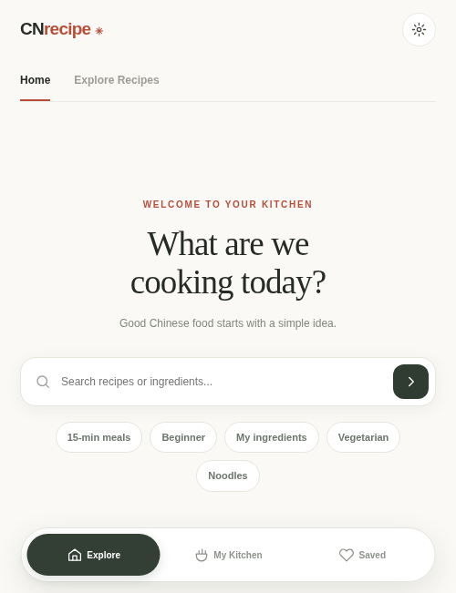

## Recipe browser

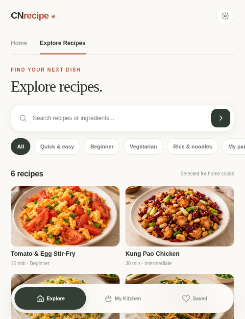

## Recipe detail

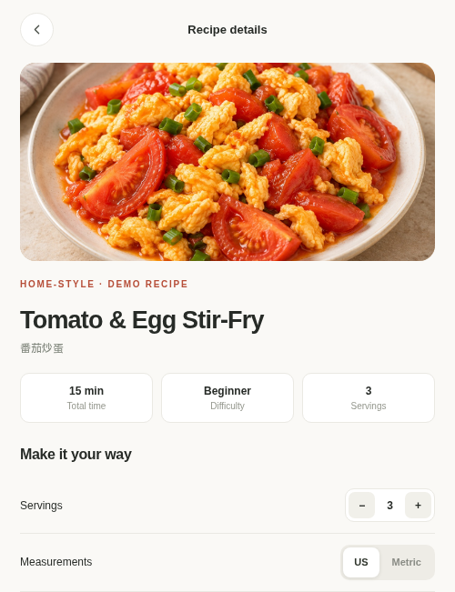

## Preparation

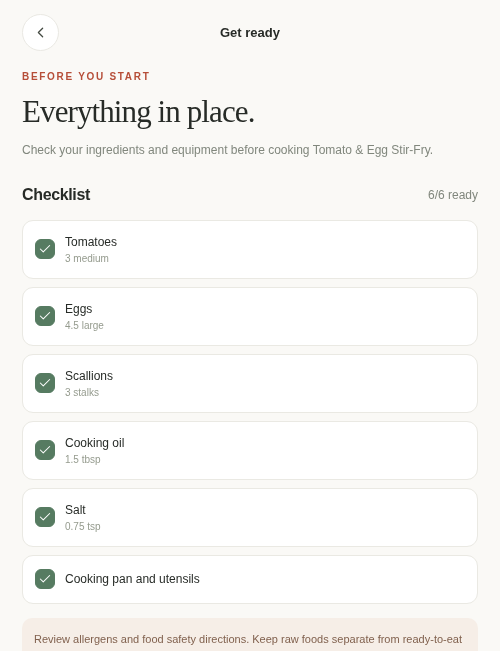

## Cooking

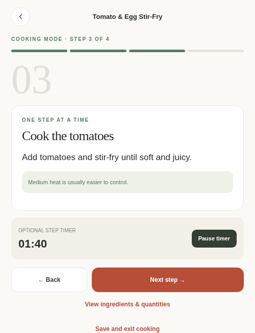

## Cooking drawer

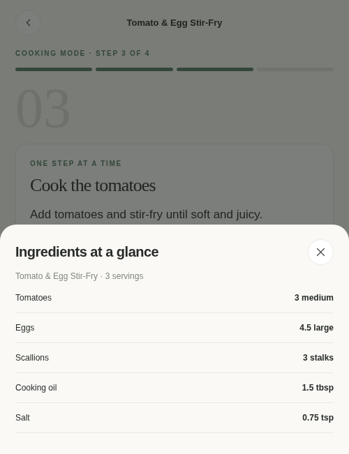

## My Kitchen

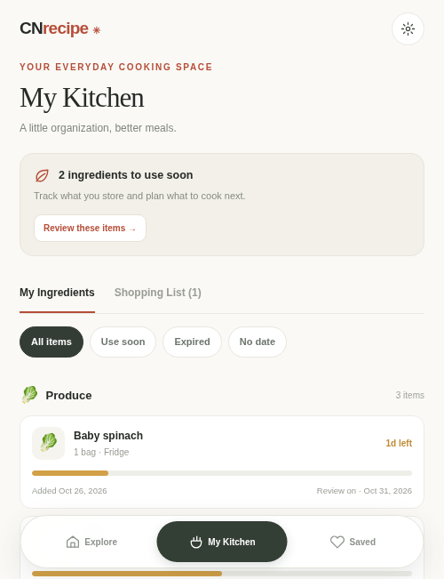

## Saved recipes

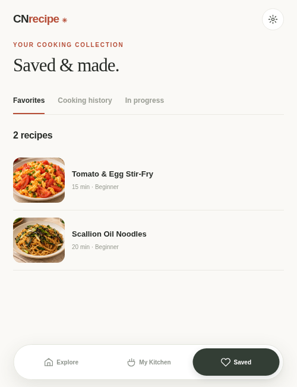

## Shopping list

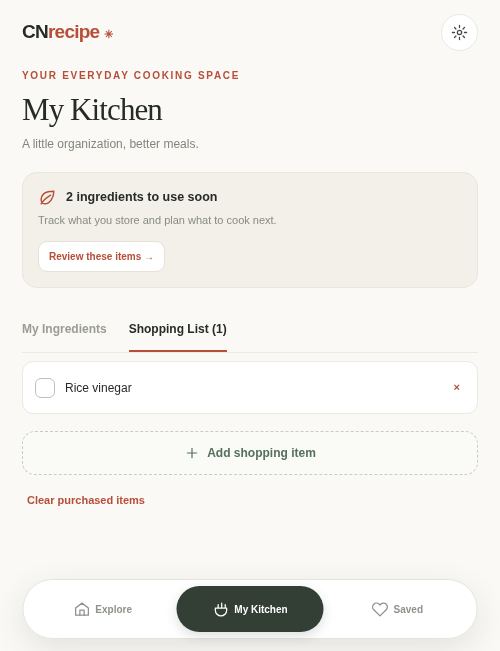

## Settings

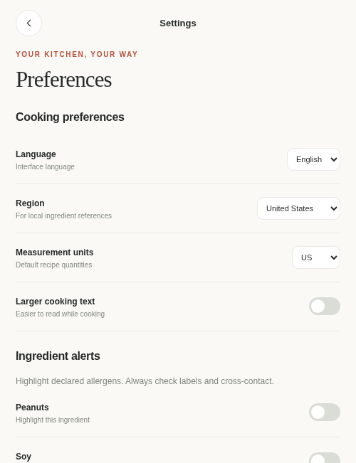

## Cooking completion

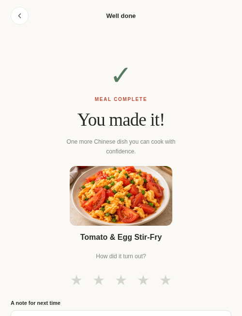

## Ingredient form

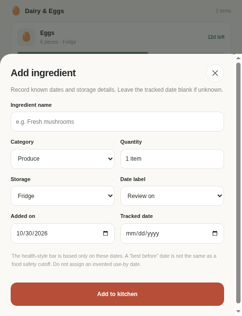

## Design overview

Earlier design boards: [Discover and kitchen](../design-handoff-2026-10-31/assets/preview-a-discover.png), [Cooking](../design-handoff-2026-10-31/assets/preview-b-cook-corrected.png), and [Supporting pages](../design-handoff-2026-10-31/assets/preview-c-support.png). These are design previews.
